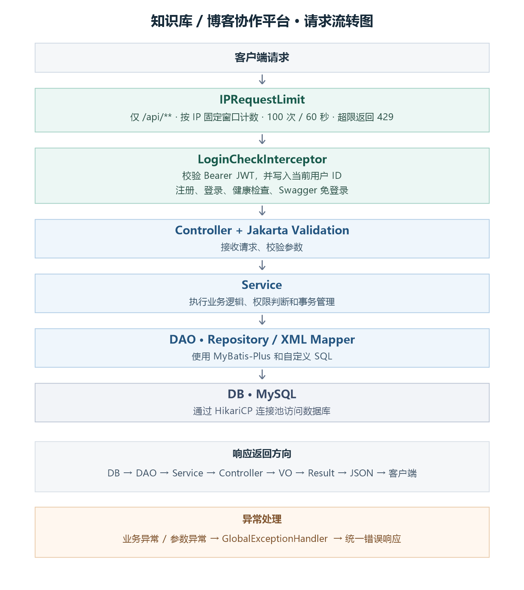

# 知识库 / 博客协作平台后端

简介：支持用户认证、文章管理、分类标签、评论互动和系统健康检查的后端平台。

## 1. 技术栈

### 1. 语言与框架

- Java 21：项目编译与运行使用的 JDK 版本。
- Spring Boot 3.5.16：应用配置、启动与依赖管理。
- Spring MVC：提供 REST API、拦截器和全局异常处理。
- Maven 3.10.0

### 2. 数据库

- MySQL 8.0+：保存用户、文章、分类、标签和评论数据。
- MyBatis-Plus 3.5.17：基础 CRUD 与自定义 XML Mapper。
- MySQL Connector/J、HikariCP：数据库驱动和连接池，版本由 Spring Boot 管理。

### 3. 认证、校验与测试

- JJWT 0.12.6：使用 HS256 签发、校验 JWT，有效期为 7 天。
- Spring Security Crypto：使用 BCrypt 保存密码哈希。
- Jakarta Validation：校验请求体和请求参数。
- Lombok：简化实体、DTO、VO 的代码。
- JUnit、Spring Boot Test、MockMvc：自动化测试支持。

其他依赖版本由 Spring Boot 3.5.16 统一管理，具体声明见 [pom.xml](pom.xml)。

## 2. 项目架构



## 3. 环境要求

- Windows 开发机：JDK 21、Git
- Linux 服务器：Docker Engine、Docker Compose、OpenSSL
- MySQL 8.0+ 由 Compose 容器提供。

## 4. Docker Compose 部署

### 1. 克隆仓库并切换到项目目录(win)

```bash
git clone https://github.com/xwmsqwg/knowledge-blog-backend.git
cd knowledge-blog-backend
```

### 2. 打包应用

```powershell
.\mvnw.cmd -q -DskipTests package
Copy-Item .\target\backend-0.0.1-SNAPSHOT.jar .\DockerCompose\knowledge_blog.jar
```

Dockerfile 使用 Java 21 JRE 镜像运行这个 JAR；Windows 上的 JDK 21 仅用于 Maven 打包。

### 3. 使用 Xftp 上传部署文件

先在 Linux 服务器创建目录：

```bash
sudo mkdir -p /usr/local/app/knowledge-blog
sudo mkdir -p /usr/local/app/mysql/{conf,data,init}
```

1. 使用 Xftp 将 `DockerCompose` 目录中的`Dockerfile`、`docker-compose.yml` 、`knowledge_blog.jar`上传到 `/usr/local/app/knowledge-blog/`。
2. 将仓库的 `database/schema.sql` 上传到 `/usr/local/app/mysql/init/schema.sql`。

### 3. 配置 `.env`

1. 生成密码和密钥(默认为随机生成，也可以自定义)
```bash
openssl rand -hex 24
openssl rand -hex 32
```

2. 切换目录，写入环境变量
```bash
cd /usr/local/app/knowledge-blog
nano .env
```

3. 在.env设置密钥与密码
- *建议*：把第 1 步第一条命令的输出填到 DB_PASSWORD= 后，第二条输出填到 JWT_SECRET= 后
```bash
DB_PASSWORD=密码
JWT_SECRET=密钥
```

在 Nano 里按 `Ctrl+O` 保存，按 `Enter` 确认文件名，再按 `Ctrl+X` 退出。

- `DB_PASSWORD` 同时用于 MySQL 和应用连接数据库。已有数据库则沿用原密码；更换 `.env` 中的值不会自动修改已有 MySQL 数据目录中的密码。
- 配置模板见 [application.example.yaml](src/main/resources/application.example.yaml)。Compose 通过 `SPRING_CONFIG_LOCATION` 显式加载 JAR 中的模板，并用 `SPRING_DATASOURCE_URL` 覆盖数据库地址；`mysql:3306` 指向同一 Compose 网络中的 MySQL 服务。

### 4. 启动

```bash
cd /usr/local/app/knowledge-blog
docker compose up --build -d
docker compose ps
```

应用和 MySQL 容器应处于 `Up` 状态。
复用原部署机器时，先确认旧容器没有占用 3306 和 8080 端口，保留数据库挂载目录。

### 5. 验证

```bash
docker logs knowledge-blog-mysql --tail=50
docker logs knowledge-blog-server --tail=50
curl -i http://localhost:8080/health
```

应看到 MySQL 的 `ready for connections`、应用的 `Started IotBackendApplication`，健康检查返回 `200` 且状态为 `UP`。

### 6. 停止

```bash
docker compose down
```


## 5. API 文档

- Swagger UI：`http://<Linux服务器IP>:8080/swagger-ui.html`
接口路径、请求参数和响应说明见 Swagger 自动生成的文档。
